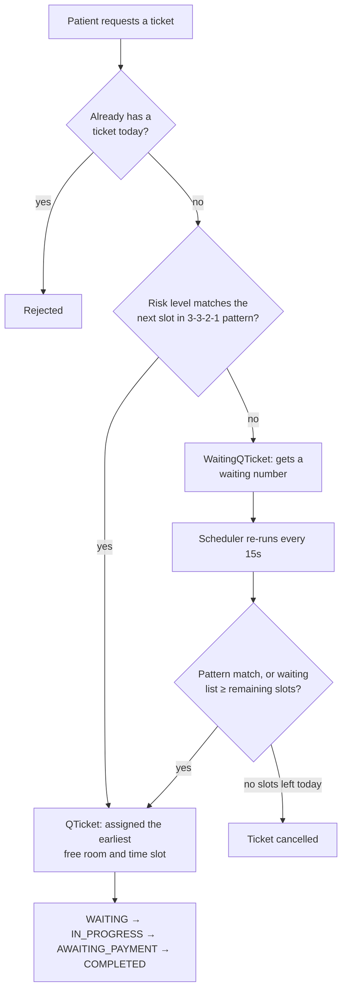
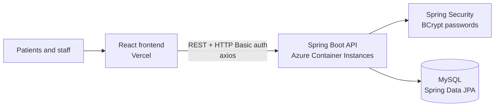

# QueueFast: Polyclinic Ticketing & Booking System

A full-stack queue management and appointment booking system for a polyclinic. Patients join the queue at a walk-in kiosk or book online. A **risk-weighted scheduler** assigns them to consultation rooms and time slots, and staff manage patients, verifications and payments from a dashboard.

**Team project** for a university software engineering module (5 developers, 140+ commits).

[**Live frontend demo →**](https://203-web-dev.vercel.app)


> Student project. Not affiliated with or endorsed by SingHealth.

---

## Features

**For patients**
- **Walk-in kiosk.** Log in with NRIC, answer a short triage questionnaire, and get a queue ticket. Anyone who answers "yes" to an urgent symptom is sent straight to the front desk instead.
- **Online booking.** See available time slots for a chosen date and book an appointment.
- **Payment.** After the consultation, pay through a generated QR code.
- **Waiting-room display.** A live "TV" header shows the current waiting number and queue length.

**For staff**
- **Patient management.** Create, view, update and delete patient records.
- **Account verification.** Approve newly registered patients before they can queue.
- **Appointment dashboard.** View all bookings and their status.

## How the queue works

Patients aren't served strictly first-come-first-served. Each patient gets a **risk level** based on age group and severity of their condition:

| Risk level | Who |
|---|---|
| **3, high** | Young or middle-aged with severe conditions; seniors with moderate or severe conditions |
| **2, medium** | Young or middle-aged with moderate conditions; seniors with mild conditions |
| **1, low** | Young or middle-aged with mild or no conditions |

The scheduler fills slots in a repeating **3 → 3 → 2 → 1** pattern. High-risk patients are seen sooner, but medium- and low-risk patients still get a guaranteed share of slots, so nobody waits indefinitely.



A Spring `@Scheduled` task runs every 15 seconds. It moves tickets through their statuses as time slots start and end, and promotes waiting-list patients into free slots. When the waiting list grows as long as the remaining slots, it stops applying the risk pattern and fills every slot, so no capacity is wasted at the end of the day.

## Architecture



| Layer | Details |
|---|---|
| **Frontend** | React 18, React Router, axios, Bootstrap, `qrcode.react` |
| **API** | Spring Boot 3 (Java 17). REST controllers for people, queue tickets, rooms and time slots, under `/api/v1` |
| **Security** | Spring Security with a database-backed `UserDetailsService`, BCrypt password hashing, role-based access (`ROLE_ADMIN` / `ROLE_PATIENT`) per endpoint, and CORS configuration |
| **Persistence** | Spring Data JPA with MySQL (PostgreSQL configuration also included). Entities: `Person`, `Room`, `DateTimeSlot`, `QTicket`, `WaitingQticket` |
| **Errors** | A global `@ControllerAdvice` handler with custom exceptions such as `AllSlotsFilledException` and `PatientNotVerifiedException` |
| **Testing** | 35 JUnit tests: service-level unit tests for queue and room logic, plus integration tests for the full queueing flow |

## Project structure

```
.
├── website/          # Spring Boot backend
│   └── src/main/java/net/csd/website/
│       ├── controller/   # REST endpoints
│       ├── service/      # QueueService (scheduling), RoomService
│       ├── model/        # JPA entities
│       ├── repository/   # Spring Data repositories
│       ├── security/     # Spring Security configuration
│       └── exception/    # Custom exceptions + global handler
└── react-frontend/   # React app
    └── src/components/   # Kiosk, online booking, staff dashboard, payment
```

## Running locally

**Backend** (needs Java 17 and a local MySQL database called `public_management_system`):

```bash
cd website
./mvnw spring-boot:run      # API on http://localhost:8080
./mvnw test                 # run the test suite
```

**Frontend:**

```bash
cd react-frontend
npm install
npm start                   # app on http://localhost:3000
```

The frontend reads the API base URL from `src/App.js`. Point it at `http://localhost:8080/api/v1` to run everything locally.

## My contributions

I built most of the **patient-facing frontend and its integration with the API**:
- The walk-in patient workflow, from registration and login through the questionnaire to the queue ticket, connected to the backend with axios
- Payment flow and QR code payment page
- The staff **verify-user** feature and the live **waiting-list display**
- Patient management screens, including a delete confirmation and replacing hard-coded URLs with configurable ones

## Team

Built with Chua Zhi Yun, Ang Xiang Ying, Ren Kai and Williams.
